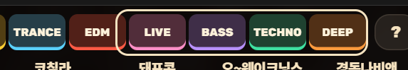

# 새 페스티벌 표준 지침 (ZONNAFE 구조 + 필수 7가지)

앞으로 만드는 페스티벌은 **ZONNAFE(존나페스티벌) 페이지의 UI/UX 구조를 그대로 따르고**, 아래 **필수 7가지**를 모두 갖춘다.
이 문서는 "무엇을 지켜야 하고, 코드 어디에 있고, 어떻게 확인하는가"를 한곳에 모은 것이다. 세부 절차는 아래 문서로 이어진다.

| 문서 | 내용 |
|---|---|
| [ADD-FESTIVAL.md](ADD-FESTIVAL.md) | 페스티벌 추가 절차 전체 (등록 → 라인업 → 사진 → 영상 → 투표 → 한도 알림) |
| [무대-많은-페스티벌-UIUX.md](무대-많은-페스티벌-UIUX.md) | 무대 6개 이상일 때 화면·배경화면 규칙 상세 |
| [영상-미리보기-플레이어-지침.md](영상-미리보기-플레이어-지침.md) | mp4 미리보기, 아이폰 자동재생 규칙 |
| [유튜브-드랍-플레이어-지침.md](유튜브-드랍-플레이어-지침.md) | 유튜브 드랍(영상이 없는 아티스트용) |

기준 구현은 `src/fest/ZonPage.tsx`(화면) · `src/fest/festMulti.ts`(배경화면) · `src/fest/zon.ts`(라인업)이다. **새 페스티벌은 이 파일들을 복사해서 시작한다.**

---

## 0. 기본 구조 (ZONNAFE에서 가져오는 것)

| 구성 | 내용 | 위치 |
|---|---|---|
| 시간표 | 무대별 세로 열, 시간 축 왼쪽, 공연 칸에 얼굴 사진·영문 이름·지정 장르 | `ZonPage.tsx`, `fest.css` (`.zon …`) |
| 고르기 | 칸 탭 = 선택/해제, 꾹 누르기 = 아티스트 창 | `ZonPage.tsx` |
| 아티스트 창 | 큰 사진(또는 2인 사진 2장), 장르 전체, 미리보기 영상/유튜브 드랍 | `parts.tsx` |
| 배경화면 만들기 | 보기 탭 `✨ AI 추천` / `전체 스테이지`, 비율, 옵션, 저장·공유, 👍/👎 | `FestExport.tsx`, `festMulti.ts` |
| 튜토리얼 | 5단계 (영상 단계 포함), 건너뛰기·끝내기 | `components/Tutorial.tsx`, `ZonPage.tsx`의 `TUT` |
| 지금 시각 줄 | 행사 중에만 표시 (`nowOn`, 문구 `f.zon.now`) | `ZonPage.tsx` |
| 문구 | ko/en/ja/zh 4개 언어. `f.<이름>.*` 키 | `strings.ts` |
| 테마 | `html:root[data-fest="<이름>"]` 의 색 토큰 + 배경화면용 look | `fest.css`, `zonLook.ts` |
| 등록 | `slug`, `aliases`, `page`, `titleKey`, 포스터, OG 이미지 | `festivals.json` |

새 페스티벌 만드는 순서(요약):

1. `festivals.json`에 항목 추가 (`ready:false`로 먼저 공개 가능) → [ADD-FESTIVAL.md 1단계](ADD-FESTIVAL.md)
2. `src/fest/zon.ts` → `<이름>.ts` 복사: 무대 목록, 공연 목록(id·무대·시작·끝·영문 이름), 지정 장르, 2인 공연 목록
3. `ZonPage.tsx` → `<이름>Page.tsx` 복사, `zonLook.ts` → `<이름>Look.ts` 복사, `fest.css`에 테마 토큰 추가
4. 얼굴 사진 → 영상 → 투표 키 등록 (아래 필수 항목 참고)
5. 이 문서의 **체크리스트(맨 아래)** 를 전부 통과시킨 뒤 배포

---

## 필수 1. 영상(YouTube / mp4) 자동 재생 + 아이폰 플레이어 점검

**규칙**

- 아티스트 창이 열리면 미리보기 영상이 **자동으로 재생**된다 (`ClipPlayer.tsx`의 `AUTOPLAY = true`).
- 아이폰(WebKit)은 소리 있는 자동재생을 막는다. 그래서 **세 단계로 내려간다**: 소리 켜고 재생 시도 → 안 되면 음소거 재생 + "소리 켜기" 버튼 → 그것도 안 되면 ▶ 덮개. 사용자가 누르면 그 탭 안에서 바로 `play()`를 부른다 (`flushSync` 후 호출).
- 영상 파일은 **H.264 + AAC, 긴 변 960px, 30fps, 최대 24초, faststart, Range 요청 가능**이어야 한다 (`scripts/make-clips.mjs`가 이렇게 만든다). 원본을 그대로 올리지 않는다.
- 영상이 있는 아티스트는 유튜브 드랍 대신 영상이 나오고, 없으면 유튜브 드랍(있다면), 그것도 없으면 영상 영역 없음.
- 튜토리얼에 영상 단계가 있다 (`TUT.clipSlug`에 영상이 있는 아티스트 id 지정).

**코드**: `src/components/ClipPlayer.tsx`, `src/clips.ts`, `public/clips.json`, `scripts/make-clips.mjs`, `upload-clips.mjs`, `check-clips.mjs`

**자주 하는 실수**

- `started` 같은 **state를 이벤트 핸들러에서 그대로 읽어** 낡은 값을 쓰게 됨 → 자동재생이 한 번도 안 시작됨 (예전에 실제로 발생). 반드시 `ref`로 읽는다.
- 개발 서버에서만 확인하고 끝냄. 개발 서버와 **빌드본의 동작이 다르다.**
- 영상 시간 길이만 보고 용량을 안 봄 → Blob 한도 (ADD-FESTIVAL.md "Blob 한도").

**확인 (코드를 바꿨으면 매번)**

```bash
npm run build
npx vite preview --port 5200                                    # 다른 터미널
node scripts/test-clip-ios.mjs http://localhost:5200 sound-blocked   # 아이폰 사파리: 소리 있는 재생 거절
node scripts/test-clip-ios.mjs http://localhost:5200 all-blocked     # 저전력 모드·앱 안 브라우저: 소리 없이도 거절
```

`test-clip-ios.mjs`는 Playwright **WebKit(아이폰 엔진)** 으로 자동재생·소리 켜기·▶ 덮개를 시험한다. 처음 한 번 `npm install --no-save playwright && npx playwright install webkit`.
기대 결과는 스크립트 맨 위 주석에 있다. 이 스크립트는 ZONNAFE의 `ak` 아티스트로 시험하므로, **새 페스티벌이면 스크립트 안의 주소·아티스트 id를 바꿔서** 돌린다.
실제 아이폰으로도 최소 한 번: 사파리와 인스타/카톡 앱 안 브라우저에서 창을 열어 본다.

---

## 필수 2. 장르(지정 장르) 표시

**규칙**

- **시간표 칸**: 아티스트 이름 **바로 아래 한 줄**, 길면 말줄임(`…`) (`.zon .blk .gn`).
- **아티스트 창**: 장르 **전체**를 표시, 테마 강조색(`--accent`), 굵게.
- **배경화면 이미지에는 넣지 않는다.** 칸이 작아서 읽히지 않고 이름·시간이 눌린다 (사용자 결정, 2026-11).
- 장르는 **주최 측이 정한 지정 장르**(엑셀 등)를 그대로 쓴다. 임의로 줄이거나 바꾸지 않는다. 출처 파일을 `<이름>Genres.ts` 맨 위 주석에 적는다.
- 2인 공연은 한 칸에 장르 하나 (지정 장르가 그렇게 온다).

**코드**: `src/fest/zonGenres.ts` (id → 장르, 103개), `zon.ts`에서 `genre: ZON_DESIGNATED[id]`로 합침, CSS `.zon .blk .gn`, `html[data-fest="zon"] .sheet .art .g`

**자주 하는 실수**: 장르 표의 아티스트 이름과 라인업 id가 달라 몇 명이 빠짐 → 합칠 때 **빠진 id가 없는지 개수를 비교**한다 (`Object.keys(장르).length === 공연 수`).

**확인**: 빌드 후 시간표 칸에 장르가 한 줄로 보이고, 긴 장르가 `…`로 끝나며, 꾹 눌러 연 창에 전체가 보인다. 폰 너비 360·390px 둘 다.

---

## 필수 3. 아티스트 얼굴 사진

**규칙**

- 모든 공연에 얼굴 사진을 넣는다. **얼굴이 칸 가로 한가운데**에 있어야 한다 (칸이 78px쯤으로 좁아 옆으로 치우치면 잘린다). 세로는 위에서 약 40% 지점.
- 원본은 사용자가 준 스크린샷. 자동으로 가운데를 자르면 몸통·배경이 나오는 사진이 있으므로 **얼굴 인식(OpenCV)으로 자르고, 인식이 틀린 사진은 눈으로 보고 좌표(`crops.json`)를 손으로 정한다.** 전부 사람 눈으로 한 번 훑어본다.
- **2인 공연**: 시간표·배경화면에는 두 사람을 합친 사진 1장(세로로 긴 조각 둘을 나란히), 아티스트 창에는 사진 2장(`{id}-1.webp`, `{id}-2.webp`)과 각자 이름. 라인업 파일의 `ZON_DUO`에 id를 적는다.
- 사진이 없는 아티스트는 이니셜 아이콘으로 나온다 (오류가 아니다). 그래도 **누락 목록을 사용자에게 보고**한다.
- 사진을 같은 이름으로 다시 올리면 `src/fest/faces.ts`의 `PHOTO_VERSION`을 올린다 (30일 캐시 때문).

**코드/절차**: [ADD-FESTIVAL.md 3단계](ADD-FESTIVAL.md) — `npm run faces`, `npm run upload-faces`, `festFace(키, id)`

**확인**: `.env.local`에 `VITE_FACE_BASE=/__faces` → `npm run dev`에서 전체 칸을 스크롤하며 얼굴이 잘린 칸이 없는지 본다. 배포본은 `VITE_FACE_BASE=https://…public.blob.vercel-storage.com/artists`로 빌드.

---

## 필수 4. AI 이미지 추천 (배경화면 `✨ AI 추천`)

**규칙**

- 배경화면 창의 보기 탭은 **`✨ AI 추천`(기본)** 과 **`전체 스테이지`** 두 개. 사용자가 고른 공연에 맞춰 **규칙으로 가장 읽기 좋은 모양을 자동으로 고른다** (AI 모델 호출이 아니라 규칙 기반이다. 서버 비용 0).
  - `packed` (2안): 고른 공연만 빽빽하게 배치. 열은 최대 5개, 한 시간대 게스트 무대는 빈 열에 끼워 넣는다.
  - `grid` (1안): 한 시간에 5팀 이상 겹치면 전체 표로 바꾼다.
  - `text` (3안): "DJ 사진 빼기"를 켰을 때, 글자만.
  - `all`: 전체 스테이지. 고르지 않은 공연은 흐리게. **고른 공연이 하나도 없는 무대는 숨긴다.**
- 미리보기 아래에 **지금 어떤 모양이 왜 골라졌는지** 한 줄 설명(`f.exp.note.*`)을 보여 준다.
- 시간은 칸 맨 위 알약, 이름은 칸 높이의 38% 이하, 60분 넘게 빈 구간은 접는다.
- **👍/👎 투표**: 모양별로 센다 (`ai:packed`, `ai:grid`, `ai:text`, `all:all`). 한 기기는 한 모양에 한 표, 바꿀 수 있다. 기기 id·IP는 저장하지 않는다. **사이트에 결과를 보여 주지 않고** 운영자만 DB에서 본다.

**코드**: `festMulti.ts`(`layoutOf`, `renderMulti`), `FestExport.tsx`(`views`, `voteFest`, `settled`), `festStats.ts`(`reportVote`, `readVote`), `api/fest-vote.ts`, `scripts/fest-votes.mjs`

**새 페스티벌에서 해야 할 일**

1. `FestExport`에 `views`와 `voteFest="키"`를 준다.
2. 키를 `festStats.ts`의 `FestKey`와 `api/fest-vote.ts`의 `FESTS`에 추가한다.
3. `render`가 돌려주는 캔버스에 `dataset.layout/view/picks/stages/busiest`가 있는지 확인 (`renderMulti`가 넣어 준다).

**자주 하는 실수**: 탭을 바꾼 직후에는 새 그림이 나오기 전까지 이전 그림이 보인다 → 그동안 이전 모양에 투표가 들어가지 않도록 `settled`로 설명·투표 줄을 숨긴다 (이미 구현됨. 건드리지 말 것).

**확인**: 고른 공연 수를 0 / 1 / 많이 / 한 시간에 5팀 이상으로 바꿔 모양이 바뀌는지, 투표 후 `node scripts/fest-votes.mjs <키>`에 잡히는지. 투표 보는 법은 ADD-FESTIVAL.md "배경화면 AI 추천 투표".

---

## 필수 5. 이미지 생성 시 최적화

사진을 올릴 때와 배경화면을 그릴 때 **둘 다** 지킨다.

**올리는 사진 (Blob 한도 보호)**

- 얼굴 사진은 **320×320 webp**로 변환 (한 장 약 10KB, 103장 약 1MB). 원본 jpg/png를 그대로 올리지 않는다 (`npm run faces`가 변환).
- 영상은 1편 약 1~2MB (필수 1의 변환 규칙).
- Vercel Hobby의 Blob은 **저장 1GB · 한 달 전송 10GB**이고, 넘으면 스토어 전체가 막혀 사진도 안 나온다. 방문자 수 × 영상 재생 횟수로 전송량을 미리 계산한다 (영상 1편 열 때마다 약 1.7MB).
- 한도에 닿았을 때를 대비해 **이메일 알림**을 켜 둔다 (`api/blob-alert.ts`, 설정은 ADD-FESTIVAL.md "한도 알림").

**배경화면을 그릴 때 (`festMulti.ts`, `festCanvas.ts`)**

- **필요한 사진만 받는다**: `packed` 모양이면 고른 공연의 사진만, 전체 표 모양이면 고른 무대의 사진만 (`ZonPage.tsx`의 `need`). 103장을 항상 받지 않는다.
- 사진은 **동시에** 받고(`Promise.all`), 느려도 **최대 4초** 뒤에는 있는 것만으로 그린다. 글꼴 로딩도 최대 2.5초 (`festCanvas.ts`). 한 장이 막혀도 화면이 안 멈춘다.
- 옵션이 바뀌면 이전 그리기는 `alive` 플래그로 **취소**하고 새로 그린다 (연타해도 낡은 그림이 덮어쓰지 않음).
- 캔버스 폭은 1080 고정 (`W`). 저장·공유용 `Blob`은 **그림이 완성되면 미리 만들어 둔다** (`blobRef`) — 아이폰은 탭한 순간 바로 공유 창을 열어야 막히지 않는다.
- "DJ 사진 빼기" 옵션은 사진을 아예 받지 않는다 (`noPhoto`) — 데이터를 쓰기 싫은 사용자용.
- 사진 주소 뒤 `?v=번호`로 캐시를 관리한다 (30일 캐시 + 번호로 갱신).

**하지 말 것**: 원본 크기 사진 업로드, 사진 전체 선로딩, 그리기 도중 새로 그리기를 막지 않는 코드, 저장 버튼을 누른 뒤에야 Blob 만들기.

**확인**: 네트워크 탭에서 사진 요청 수·크기를 본다 (고른 공연 수만큼만). 빌드 후 배경화면이 1~2초 안에 나오는지.

---

## 필수 6. 무대가 6개 이상일 때만: 현재 위치 지도 (스테이지 지도 바)



위 그림처럼 **무대 이름이 한 줄로 늘어선 바**가 있고, 지금 화면에 보이는 범위가 **테두리 상자**로 표시된다. 옆으로 밀면 상자가 따라 움직이고, 바의 무대 이름을 누르면 그 무대로 이동한다.

**규칙 (`ZonPage.tsx` 맨 위 상수)**

```ts
const MAP_MIN_STAGES = 6;
const MANY = ZON_STAGES.length >= MAP_MIN_STAGES;
```

| 무대 수 | 화면 |
|---|---|
| **6개 이상** (`MANY`) | 가로로 밀어서 보기 (한 화면에 약 4.3열 — 다음 열이 살짝 보여 "밀면 더 있다"를 알려 줌). **지도 바 + 테두리 상자** 표시. 처음 한 번 살짝 밀어 보이는 안내(nudge). |
| **5개 이하** | 열 너비를 화면에 **딱 맞춰** 전부 한눈에 보이게 (`FIT_STYLE`의 `--cw`). **지도 바 없음, 가로 스크롤 없음.** |

- 지도 바 자체는 `.zon-map`(열 수는 CSS 변수 `--n`), 테두리 상자는 `.zon-view`.
- 무대 5개 이하에서 지도를 억지로 넣지 않는다. 보이는 게 전부라 군더더기이기 때문이다.
- 상세(칸 크기, 무대 이름 줄, 쓰지 않기로 한 안)는 [무대-많은-페스티벌-UIUX.md](무대-많은-페스티벌-UIUX.md).

**가로 밀기가 매끄러워야 한다 (안드로이드 크롬에서 천천히 밀 때 버벅이던 문제, 2026-11)**

- 무대 이름 줄(`.zon-heads`)은 **스크롤러가 아니다.** 시간표(`.zon-scroll`)만 스크롤하고, 이름 줄은 따라가기만 한다. 두 스크롤러가 서로 `scrollLeft`를 덮어쓰게 만들지 않는다.
- 같은 이유로 가로 스크롤러에 `scroll-snap`을 걸지 않는다 (느린 드래그에서 끼어들어 되돌린다). 무대 지도의 테두리 상자(`.zon-view`)에도 `left` 트랜지션을 주지 않는다.
- 스크롤은 컴포지터 스레드에서 처리돼서, 자바스크립트로 이름 줄을 옮기면 한 프레임 늦게 따라가 천천히 밀 때 이름 줄과 열이 미세하게 떨린다. 그래서 **스크롤 연동 애니메이션**(`animation-timeline`, `ZonPage.tsx`의 `cssSync`, `fest.css`의 `zon-head-follow`)으로 같은 프레임에 움직이게 한다. JS는 시간표 폭이 바뀔 때만 `--range`를 알려 주고, 이 기능이 없는 브라우저는 예전처럼 JS `transform`으로 따라간다.
- 스크롤 이벤트마다 `scrollWidth`·`clientWidth`를 읽지 않는다 (매 프레임 강제 레이아웃). 크기는 `measure()`에서 바뀔 때만 잰다.
- 확인: 폰 크롬(안드로이드)에서 **빠르게도, 아주 천천히도, 비스듬히도** 밀어 본다. 이름 줄과 열이 같이 움직이고, 되돌아가거나 튀지 않아야 한다.

**자주 하는 실수**: 무대가 적은데 가로 스크롤이 남아 있음 / 무대가 많은데 `--cw`를 고정해 한 화면에 4.3열이 안 나옴. 둘 다 위 상수만 보고 분기하면 된다 (다른 곳에서 따로 판단하지 않는다).

**확인**: 폰 360·390px에서 — 6개 이상이면 지도 바·테두리 상자·밀기 가능, 5개 이하면 지도 바 없음·모든 열이 한 화면에 보임·가로 스크롤 없음·페이지 가로 넘침 없음. (실제 구현 때 7무대 / 5무대 두 경우를 모두 시험했다.)

---

## 필수 7. ✕ 버튼이 홈페이지로 가는 문제 (창만 닫고 그 자리에 머물기)

**규칙**

- 아티스트 창의 ✕, 튜토리얼의 건너뛰기/끝내기/✕, 폰의 뒤로가기 — **어느 것을 눌러도 그 페스티벌 시간표 화면에 그대로 머물고, 창·튜토리얼만 닫힌다.** 홈(`/`)으로 가면 안 된다.
- 창이 열릴 때 `history`에 한 칸을 넣고, 닫을 때 그 칸을 뺀다 (`src/backClose.ts`의 `useBackClose`). 모든 창·시트·튜토리얼은 반드시 이 훅으로 연다. 직접 `history.pushState`를 쓰지 않는다.
- **넣어 둔 history 칸 수(`pushed`)와 열려 있는 창 수(`stack.length`)를 항상 같게 맞춘다.** 닫을 때 바로 `back()`하지 않고 한 틱 뒤(`reconcile`)에 맞춘다.

**원인 (예전 버그)**: React 개발 모드(StrictMode)가 "열기 → 닫기 → 다시 열기"를 한 번에 실행하면서 history 칸이 어긋났고, ✕를 누르면 한 칸 더 뒤로 가서 홈이 열렸다. 튜토리얼이 아티스트 창을 열었다 닫는 흐름에서도 같은 일이 생겼다.

**자주 하는 실수**: 창을 닫는 핸들러에서 `history.back()`을 직접 호출 / 창마다 따로 pushState / 개발 서버가 아닌 빌드본에서만 시험 (StrictMode 문제는 **개발 서버에서만** 드러나므로 둘 다 시험).

**확인 (새 페스티벌마다, 창·튜토리얼을 건드렸다면 매번)**

```bash
npm run dev                  # 다른 터미널
node scripts/test-back-close.mjs http://localhost:5173 <페스티벌 주소> <튜토리얼 저장 키> [칸 선택자]
# 예) node scripts/test-back-close.mjs http://localhost:5173 zonnafe-2026 fl:zon:tut
```

홈에서 카드를 눌러 들어온 상태(뒤에 홈이 있는 상태)로 ① 아티스트 창 ✕ ② 창 열고 뒤로가기 ③ 튜토리얼 3단계(시연 창이 열린 상태)에서 건너뛰기 ④ 튜토리얼 끝까지 — 네 가지가 모두 `PASS`여야 한다. `npm run build && npx vite preview`로도 한 번 더 돌린다.

---

## 새 페스티벌 체크리스트 (배포 전 전부 체크)

기본
- [ ] `npm run build` 통과 (라인업 일치·타입·영상 목록 검사 포함)
- [ ] `/{slug}` 와 별칭 주소가 열린다, 4개 언어 문구가 비지 않는다, 푸터에 비공식·권리 안내
- [ ] 링크 미리보기(`og.title`·`og.desc`·`og.img`), 홈 카드 순서·D-day

필수 7가지
- [ ] 1. 영상: 빌드본 + WebKit(`test-clip-ios.mjs`) 통과, 실제 아이폰 사파리·앱 안 브라우저에서 자동재생(또는 ▶/소리 켜기) 확인
- [ ] 2. 장르: 시간표 칸 한 줄 + `…`, 아티스트 창에 전체, 배경화면에는 없음, 빠진 id 없음
- [ ] 3. 얼굴: 전부 가로 한가운데, 2인 공연은 합친 1장 + 개별 2장, 누락 목록을 보고
- [ ] 4. AI 추천: 모양 4종 전환·설명 줄·👍/👎 저장(`fest-votes.mjs`로 확인), `FestKey`/`FESTS` 등록
- [ ] 5. 최적화: 사진 320×320 webp, 필요한 사진만 로딩, 4초/2.5초 제한, 공유용 Blob 미리 생성, Blob 한도 계산 + 이메일 알림 설정
- [ ] 6. 지도: 무대 6개 이상 → 지도 바 + 테두리 상자 + 가로 밀기 / 5개 이하 → 지도 없이 한 화면에 꽉 차게
- [ ] 7. ✕: `test-back-close.mjs` 네 가지 PASS (개발 서버 + 빌드본)

폰 너비 360·390px에서 레이아웃이 깨지지 않고, 페이지 가로 넘침이 없다.

## 시험 스크립트 한눈에

| 스크립트 | 무엇을 | 언제 |
|---|---|---|
| `scripts/test-clip-ios.mjs` | 아이폰 엔진(WebKit)에서 영상 자동재생 | 플레이어·영상 변환 바꿀 때, 새 페스티벌 영상 추가 때 |
| `scripts/test-back-close.mjs` | ✕·뒤로가기가 홈으로 안 가는지 | 창·튜토리얼·`backClose.ts` 건드릴 때, 새 페스티벌 때 |
| `scripts/fest-votes.mjs <키>` | 👍/👎 투표 결과 보기 (나만) | 배치를 다듬을 때 |
| `scripts/test-alert-mail.mjs` | Blob 한도 알림 메일 시험 | 알림 설정 직후 |
| `scripts/check-clips.mjs` | `clips.json`에 있는 영상이 Blob에 올라갔는지 (빌드에 포함) | 자동 |

---

## 적용 사례

| 페스티벌 | 무대 | 사진 | 영상 | 장르 | 비고 |
|---|---|---|---|---|---|
| ZONNAFE 2026 (`ZonPage.tsx`) | 7 (지도 바 + 가로 밀기) | 103 | 87 | 주최측 지정 장르 | 기준 구현 |
| ULTRA TAIWAN 2026 (`UtwPage.tsx`) | 2 (한 화면에 꽉 차게, 지도 없음) | 15 | 없음 | 웹 검색 (`utwGenres.ts`) | ZonPage 복사 + 상수만 변경 |

**ULTRA TAIWAN에서 새로 정한 규칙**

- **시간표에 시작 시각만 있을 때**: 끝나는 시각은 같은 무대의 다음 공연 시작(마지막은 폐장)으로 추정해서 `rows()`에 `"~HH:MM"`으로 적는다. 시간표 칸과 배경화면에는 "12:45 –"처럼 **시작 시각만** 보여 준다 (추정한 끝 시각을 확정처럼 보이지 않게. `festMulti.ts`의 `timeStr`).
- **해외 페스티벌**: `FDay.utc`(대만 +8)에 현지 시차를 적고, 지금 시각 줄은 현지 시각으로 계산한다 (`UtwPage.tsx`의 `nowMin`). `festivals.json`에도 `"utc"`.
- **장르를 검색으로 정리할 때**: 출처를 `<이름>Genres.ts` 맨 위 주석에 적고, 한두 곳에서만 확인했거나 동명이인일 수 있으면 `conf: "inferred"`(화면에 ~가 붙는다). 찾지 못한 아티스트는 **장르를 비워 둔다** (지어내지 않는다).
- **홍보 포스터에서 얼굴을 자를 때**: 포스터 로고가 걸리면 그 모서리만 어둡게 덮는다 (212 OMARA).
- **무대가 3곳 이하**일 때 칸 너비 상한을 132px → 200px로 늘린다 (`UtwPage.tsx`의 `FIT_STYLE`). 그래야 2열이 폰 화면을 채운다.
- 새 페스티벌 키를 넣을 곳: `registry.tsx`, `festStats.ts`(`FestKey`·`FEST_DAYS`·`DEMO_META`), `api/fest-download.ts`, `api/fest-stats.ts`, `api/fest-vote.ts`(`FESTS`), `scripts/sync-lineup.mjs`, `strings.ts`(4개 언어), `fest.css`(`html[data-fest="…"]` 테마), `festivals.json`.
